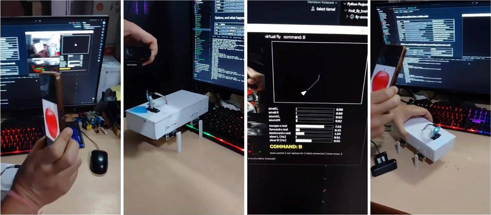
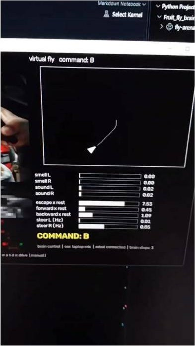
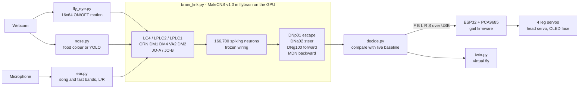
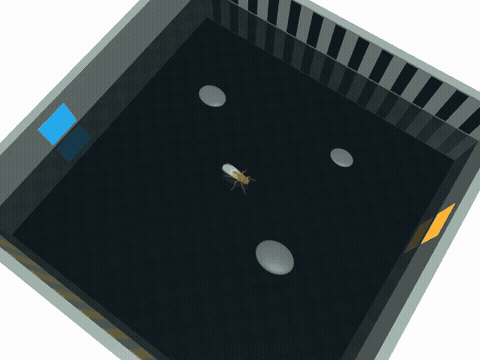
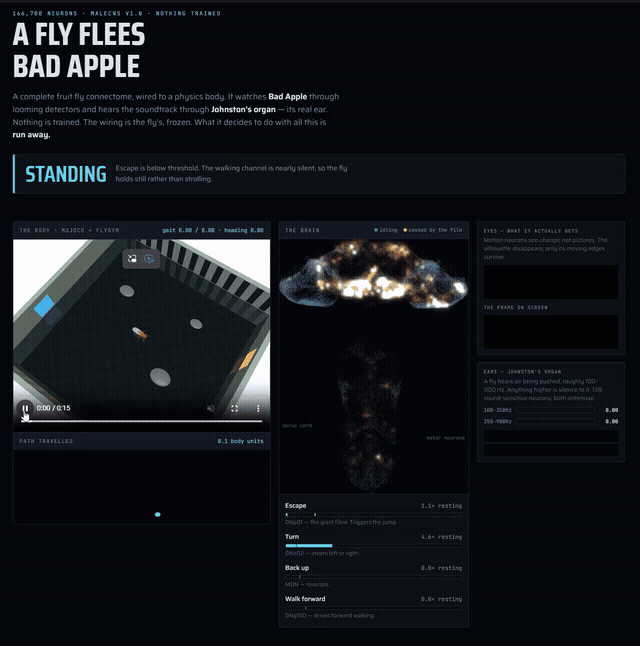

# MaleCNS-Quadruped

**A four-legged robot driven live by a real fruit-fly brain.**

The complete wiring diagram of a male fruit fly's central nervous system
(the **MaleCNS v1.0 connectome**, about 166,700 neurons and 25.6 million synapses)
runs as a spiking simulation on a GPU. A webcam and a microphone are its senses.
The brain's own "escape", "turn", "walk" and "back up" neurons decide what a small
ESP32 servo robot does.

Nothing is trained. The connectome is never changed. The wiring of a real animal does the deciding.



**Demo video (2 min):** [Instagram reel on @vaibhav_labs](https://www.instagram.com/p/DfZHeC4tE04/)

---

## What it does

| You do this | The fly brain does this | The robot does this |
|---|---|---|
| Move a hand or object quickly toward the camera (looming) | Looming-detector neurons (LC4, LPLC2) drive the giant-fibre escape neuron **DNp01** far above its resting rate | Backs away (`B`). The OLED fly face widens its eyes |
| Show food (an apple) to one side | Food-odour receptor neurons (and optionally the LC10a "target" neurons) are driven on that side; the steering neurons **DNa02** left/right are compared | Turns (`L` / `R`); the head servo points where the brain wants to turn |
| Play a sound to one side | Johnston's organ (the fly's ear, JO-A / JO-B) is driven on that side | Mixes into the same decision |
| Nothing happens | The network idles at its own background activity | Stands still (`S`) |

A **virtual fly** on screen receives exactly the same commands as the real robot, so you
can compare what the brain decided with what the body did.

<p align="center"></p>

## How it works



This is the same split real animals and other connectome-body projects use:

* **The brain decides *what* to do** (escape, turn, walk, stop) and which side.
* **The body's pattern generator decides *how* the legs move.** The ESP32 runs a fixed
  diagonal walking gait. Nobody has a validated map from fly motor neurons to fly
  muscles yet, let alone to hobby servos, so the legs are not driven neuron by neuron.

Details and neuron lists are in [docs/HOW_IT_WORKS.md](docs/HOW_IT_WORKS.md); every setting is in [docs/SETTINGS.md](docs/SETTINGS.md).

## Honest results

* **The escape reflex works reliably.** A looming hand pushes DNp01 to many times its
  resting rate and the robot backs off. In the offline simulation (below) the escape
  neuron ran at about **55x** its resting rate while the fly watched a looming video.
* **Steering works but has a left bias.** In most runs the left DNa02 neuron fires more
  than the right one even at rest. The likely cause is the model, not the robot: smell
  input reaches both sides of the brain, and each steering group is a single neuron.
  The live baseline reduces it but does not remove it.
* **It is open loop.** The brain gets no feedback from the legs (no efference copy,
  no proprioception). It only sees the result through the camera.
* **The decision thresholds are hand-set** (escape at 4x rest, steer gap 0.5, and so on).
  They are listed in one place in `decide.py` so they can be measured and justified
  instead of tuned to look good.
* **The fly learns nothing.** The connectome is frozen. There is no reward and no memory.

## Simulation work that came first

Before the robot, the same brain was tested offline on video and sound, and was used
to drive a simulated fly body (MuJoCo / FlyGym) in a 3D arena.

| Simulated fly fleeing in the arena | Brain dashboard while watching a looming video |
|---|---|
|  |  |

Key findings (full tables in [docs/RESEARCH_NOTES.md](docs/RESEARCH_NOTES.md)):

* Driving 6,006 photoreceptors directly gets nowhere (scores at chance), because a
  spiking model cannot relay the graded signals of the real lamina. Six well-placed
  inputs into the looming detectors work far better.
* Sound reaches the ear (about 60x rest) and spreads two synapses deep (about 10x),
  but never engages the courtship-song circuit. That is the correct biology: music is
  not fly song.
* Vision plus sound together drive steering and backing up more than either alone,
  a first sign the network mixes the senses rather than just passing them through.

## Repository layout

```
MaleCNS-Quadruped/
  fly-vision/            Python: the brain side (runs on the PC)
    live/                the live robot program, one small file per job
      run_live.py        everything in one window (start here)
      camera.py          any webcam or stream, always the newest frame
      fly_eye.py         picture -> fly-style low-res ON/OFF motion
      nose.py            food -> smell left/right (colour or YOLO)
      ear.py             microphone -> fly ear bands, left/right
      brain_link.py      senses -> MaleCNS neurons -> behaviour firing rates
      decide.py          firing rates -> one command F/B/L/R/S
      robot_link.py      USB serial to the ESP32
      twin.py            the on-screen virtual fly
      GUIDE.md           plain-language guide to every file
    fly_pipeline.py      offline video -> brain -> readout experiments
    visual_spike_encoder.py, audio_spike_encoder.py, inspect_pipeline.py
    fly_body.py          brain driving the simulated MuJoCo fly
  fly_body/              C++ (PlatformIO): the ESP32 robot firmware
    src/main.cpp         walking gait, serial commands, head servo, watchdog
    src/face.cpp         animated fruit-fly face on the OLED
    src/mic.cpp          optional on-robot microphones
  docs/
    SETUP.md             install, GPU or CPU, data, firmware, troubleshooting
    SETTINGS.md          every option and tunable number
    HOW_IT_WORKS.md      neurons, decision rules, thresholds
    HARDWARE.md          parts list, wiring, power
    RESEARCH_NOTES.md    simulation results and known traps
    media/               photos and clips
```

Every Python module in `live/` can be run on its own to test just that part
(see [fly-vision/live/GUIDE.md](fly-vision/live/GUIDE.md)).

## Quick start

You need Python 3.11+ and [uv](https://docs.astral.sh/uv/). An NVIDIA GPU makes the brain
run in real time; a CPU works too, just slower. The full step-by-step guide (Windows and
Linux, GPU and CPU, data, firmware, troubleshooting) is in **[docs/SETUP.md](docs/SETUP.md)**.

```bash
git clone https://github.com/VaibhavBansa1/MaleCNS-Quadruped.git
cd MaleCNS-Quadruped/fly-vision
uv venv --python 3.12
uv pip install flybrain numpy opencv-python scipy sounddevice pyserial
uv pip install ".[cuda]"          # optional: NVIDIA GPU
uv pip install ultralytics        # optional: YOLO food detector

uv run python live/brain_link.py  # first run downloads the brain (~260 MB); says "brain ready on cuda" or "cpu"
uv run python live/run_live.py    # finds the camera and robot by itself
```

Keep the scene still for the first 8 seconds (the live resting baseline), then click
the food in the camera picture.

| Run it like this | Command |
|---|---|
| Screen only, no robot | `uv run python live/run_live.py --port none` |
| Force GPU / CPU | `--device cuda` / `--device cpu` |
| Pick a camera or a phone stream | `--camera 1` / `--camera http://192.168.1.20:8080/video` |
| Find food with YOLO | `--nose yolo --target apple --food-as-target` |
| No microphone | `--mic none` |

| Key | Does |
|---|---|
| click the food | teach the colour nose what food looks like |
| space | pause / resume the robot (the brain keeps running) |
| m | brain control / manual control |
| w a s d x | drive by hand in manual mode |
| 0 | reset the virtual fly |
| r | recalibrate (keep the scene still 8 s) |
| q | quit (robot stops) |

Flash the robot with PlatformIO: open `fly_body/` in VS Code and press Upload.

## Documentation

| Document | What is in it |
|---|---|
| [docs/SETUP.md](docs/SETUP.md) | Install on Windows or Linux, GPU vs CPU, getting the connectome data, flashing the firmware, testing each part alone, every way to run it, troubleshooting |
| [docs/SETTINGS.md](docs/SETTINGS.md) | Every command-line option, environment variable, key, threshold and firmware constant: default and what changing it does |
| [docs/HOW_IT_WORKS.md](docs/HOW_IT_WORKS.md) | The senses, which neurons are driven and read, the decision rules, the gait, known limitations |
| [docs/HARDWARE.md](docs/HARDWARE.md) | Parts, wiring, power, serial commands, measured robot speed |
| [docs/RESEARCH_NOTES.md](docs/RESEARCH_NOTES.md) | Offline simulation results with all tables, and the traps found on the way |
| [fly-vision/live/GUIDE.md](fly-vision/live/GUIDE.md) | Plain-language tour of every Python file |

## Hardware at a glance

ESP32 dev board, PCA9685 16-channel servo driver, 4x MG90S leg servos,
1x 180-degree head servo, 0.96" SSD1306 OLED (the fly face), a USB webcam,
a 5-6 V supply for the servos, and a cardboard body. Total cost is a few
hundred rupees beyond the PC.

## Credits

* **Connectome:** MaleCNS v1.0, the male *Drosophila* central nervous system
  connectome from Janelia Research Campus (FlyEM) and collaborators. Please cite
  their publication and follow their data terms if you use it.
* **Simulator:** the [`flybrain`](https://pypi.org/project/flybrain/) Python package
  (leaky integrate-and-fire on sparse GPU matrices).
* **Simulated body:** MuJoCo and FlyGym, through the male-cns-arena project, used
  only for the offline simulation videos.
* **Object detection:** Ultralytics YOLOv8n (optional food detector).

## Author

**Vaibhav Bansal**, B.Tech Information Technology, MITS Gwalior.
GitHub [@VaibhavBansa1](https://github.com/VaibhavBansa1) ·
Instagram [@vaibhav_labs](https://www.instagram.com/vaibhav_labs/) ·
LinkedIn [vaibhavbansal3](https://www.linkedin.com/in/vaibhavbansal3)

## License

The code in this repository is MIT licensed (see [LICENSE](LICENSE)).
The connectome data and third-party libraries keep their own licenses.
