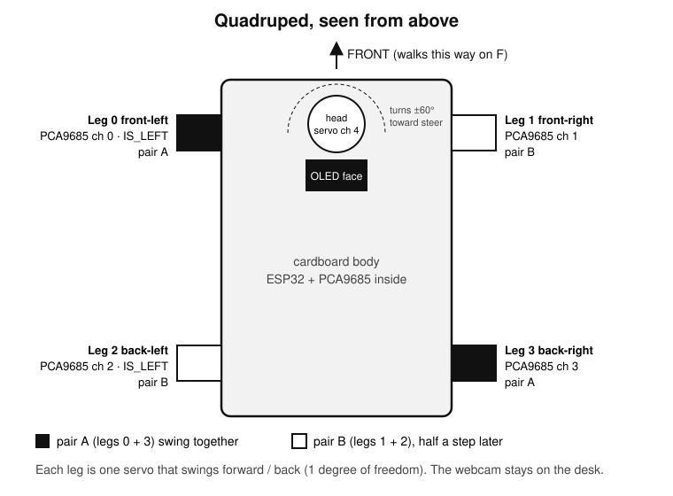
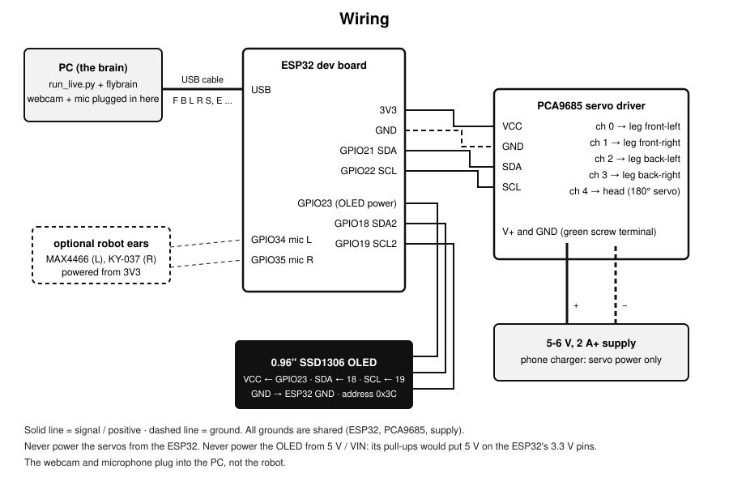
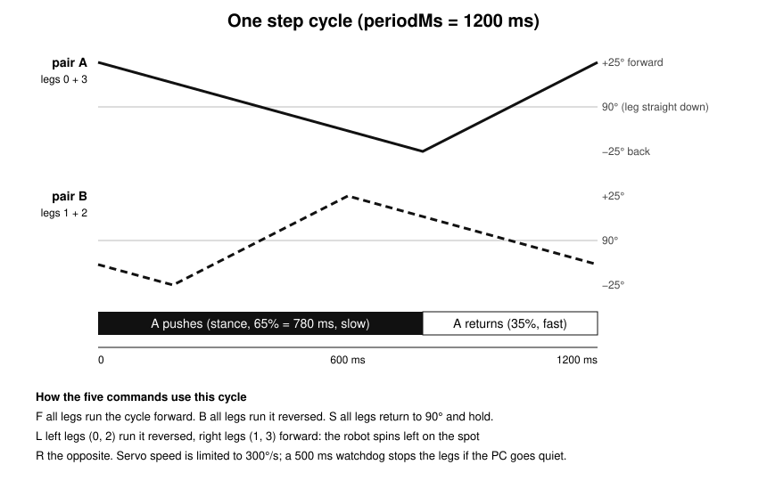

# Hardware







## How the body works

* **Four legs, one servo each.** Every leg is a flat stick on a micro-servo horn that
  swings forward and back around "straight down" (90 degrees). There is no knee joint.
* **Diagonal gait.** Front-left and back-right (pair A) move together; front-right and
  back-left (pair B) move half a cycle later. Each leg pushes back slowly for 65% of the
  cycle while it carries weight, then swings forward quickly, so the robot creeps forward.
* **Turning on the spot.** For `L` the left legs run the cycle backwards while the right
  legs run it forwards (the reverse for `R`).
* **Head and face.** The head servo turns up to 60 degrees toward the side the brain
  wants to steer. The OLED shows a fruit-fly face that reacts: wide eyes on escape,
  closed eyes when the PC goes quiet, a B / M letter for brain or manual control.
* **Safety.** Servo speed is capped at 300 degrees/s, legs move to 90 degrees one at a
  time at power-up, and a 500 ms watchdog stops the legs if the PC program stops.

## Build it

1. Mount the four leg servos at the corners of a light cardboard box, shafts pointing
   sideways, and glue a flat stick to each servo horn as the leg.
2. Before fixing the horns, send all servos to 90 degrees (power the board and it does
   this by itself) and fit each leg pointing straight down.
3. Mount the head servo at the front, shaft up, and stick the OLED on its horn so the
   face turns with the head.
4. Put the ESP32 and PCA9685 inside the box and wire them as shown. Keep the servo
   supply leads short and thick.
5. Flash the firmware ([SETUP.md](SETUP.md#5-flash-the-robot-firmware)), then use `T 0`
   ... `T 3` and the settings below to match the code to your legs.

## Parts

| Part | Used for |
|---|---|
| ESP32 dev board (NodeMCU ESP-32S, CP210x USB chip) | Receives commands over USB, runs the gait |
| PCA9685 16-channel PWM servo driver | Drives all servos from two I2C wires |
| 4x MG90S micro servos | Legs |
| 1x 180-degree micro servo | Head (turns toward where the brain wants to steer) |
| 0.96" SSD1306 I2C OLED, 128x64 (yellow + blue) | The animated fruit-fly face |
| USB webcam | The fly's eyes and nose (it stays on the desk, not on the robot) |
| Laptop / PC microphone | The fly's ears |
| Optional: MAX4466 and KY-037 analog mic modules | On-robot ears: left on GPIO34, right on GPIO35, both powered from 3.3 V (`--mic esp`) |
| 5-6 V, 2 A or more supply (a phone charger worked) | Servo power only |
| Cardboard box, ice-cream sticks, glue | The body |

## Wiring

```
ESP32                 PCA9685
3V3  ---------------- VCC        (logic power only)
GND  ---------------- GND
GPIO21 (SDA) -------- SDA
GPIO22 (SCL) -------- SCL

5-6 V supply + ------ V+  (green screw terminal)   servo power, NOT from the ESP32
5-6 V supply - ------ GND (green screw terminal)   share ground with the ESP32

PCA9685 channel 0 --- front-left leg
PCA9685 channel 1 --- front-right leg
PCA9685 channel 2 --- back-left leg
PCA9685 channel 3 --- back-right leg
PCA9685 channel 4 --- head servo (180 degree)

ESP32                 OLED (second I2C bus, Wire1)
GPIO23 -------------- VCC   (the OLED draws only a few mA, a GPIO set HIGH can power it)
GND  ---------------- GND
GPIO18 -------------- SDA
GPIO19 -------------- SCL
```

Do **not** power the OLED from the 5 V / VIN pin: its I2C pull-ups would then pull the
ESP32's 3.3 V pins up to 5 V.

## Settings to match your build (top of `fly_body/src/main.cpp`)

| Setting | What it does |
|---|---|
| `LEG_CH[4]` | Which PCA9685 channel each leg is on |
| `SIDE_SIGN[4]` | Flip a leg that swings the wrong way |
| `IS_LEFT[4]` | Which legs are on the left (swap if L and R turns are reversed) |
| `TRIM_US[4]` | Straighten a leg that is not vertical at 90 degrees |
| `HEAD_SIGN` | Flip if the head looks right when the brain says left |
| `ampDeg`, `periodMs`, `duty` | Step size, step time, push / return ratio |

`FACE_MIRROR` at the top of `face.cpp` flips the eyes if they look the wrong way.

## Serial commands (115200 baud, one per line)

| Command | Meaning |
|---|---|
| `F` `B` `L` `R` `S` | forward, backward, turn left, turn right, stop |
| `H <deg>` | head angle 0-180 |
| `A <deg>` / `P <ms>` / `D <pct>` | step size / step period / stance percent |
| `W <ms>` | watchdog: stop if no command arrives in this time (0 = off). The PC sets 500 ms |
| `E <mode> <steer> <escape>` | status for the face and head: mode 1 brain / 0 manual, steer -1..1, escape 1/0 |
| `T <n>` | test one leg: leg n swings to its "forward" for 1.5 s |
| `M 1` / `M 0` | start / stop sending on-robot microphone levels |

Test the robot without the brain:

```bash
cd fly-vision
uv run python live/robot_link.py --list     # find the port
uv run python live/robot_link.py COM4       # then type F, L, S ...
```

## Measured on the real robot

* Walks about 1 cm every 1.5 s (0.67 cm/s) and turns about 4-5 degrees per second on a
  smooth table. Slow, but the legs are cheap micro servos with cardboard feet.
* The virtual fly in `twin.py` uses these numbers, so screen and robot move at the same pace.
